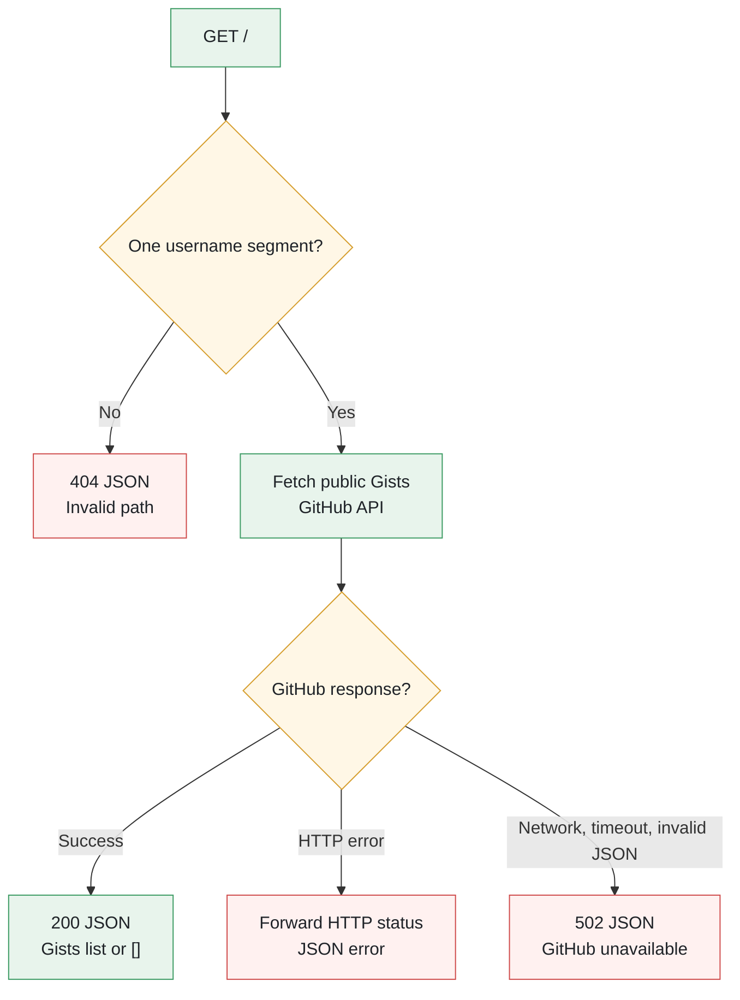

# GitHub Public Gists API

`GET /<username>` fetches that GitHub user's public Gists and returns them as
JSON. `.env` sets the API port to `8080`. No third-party Python
packages or GitHub token are required.

## Configuration and logs

The app loads these values from `.env` automatically when run locally. Docker
receives the same values through `--env-file`.

- `PORT`: listening port (`8080`).
- `GITHUB_API_TIMEOUT_SECONDS`: GitHub request timeout in seconds (`10`).
- `LOG_LEVEL`: application log level (`INFO`).

Startup and GitHub errors are logged. Docker captures logs for `docker logs`.

## Request flow



## Run locally

Requires Python 3.10 or later.

The app loads `.env` automatically when you start it:

```sh
python3 app.py
```

In a second terminal, request a user's Gists:

```sh
curl http://localhost:8080/octocat
```

Check that the API process is responsive without calling GitHub:

```sh
curl http://localhost:8080/health
```

## Run tests

Run the full suite:

```sh
python3 -m unittest discover -s tests -v
```

The tests mock GitHub and do not require network access.

Run one test case:

```sh
PYTHONPATH=tests python3 -m unittest test_app.GistAPITest.test_returns_users_gists -v
```

Replace the final method name to run a different test.

## Run with Docker

```sh
docker build -t public-gists-api .
docker run --rm --env-file .env -p 8080:8080 public-gists-api
```

Docker periodically checks `/health` and reports the container status. If you
change settings in `.env`, Docker passes them into the container.